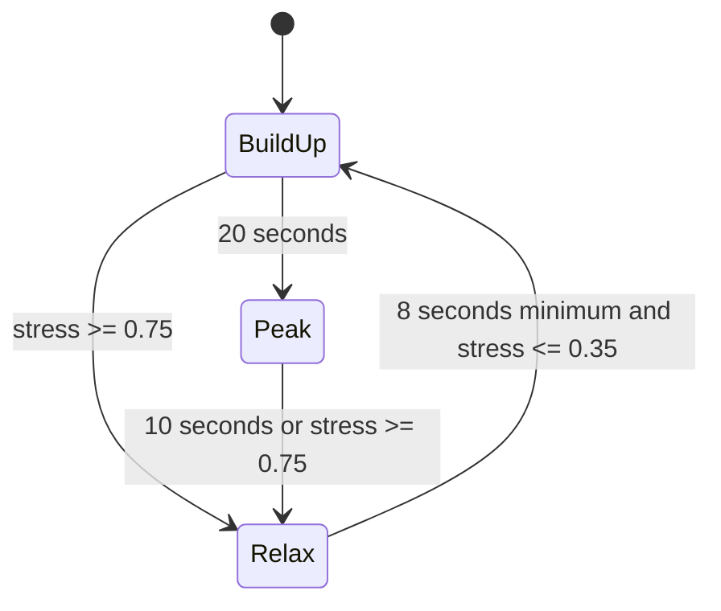

# Adaptive Spawn Director — Individual Report Draft

**Student:** Premarathna P A I B — IT24101844  
**Module:** SE3062 Intelligent Systems  
**Role:** Spawn Director  
**Project:** Interactive 3D shooting game

## Problem and responsibility

A fixed timer can spawn enemies regardless of whether the player is struggling. My director selects when, which enemy profile and where to spawn using current player condition and navigation constraints. It manages enemies that it creates. The adaptive boss, stealth enemy and trap setter are separate team responsibilities.

## Architecture and percepts

The agent combines a finite state machine with utility-based selection. Player health and the remaining throwable-rock supply are normalized to 0..1 through a bridge to the existing PlayerStats and PlayerThrower components. Nearby pressure counts active enemies owned by this director within the configured radius. The current gameplay/player-alive gates prevent spawning after death or inactive play. The MainLevel bridge also checks boss victory.

The throwable supply is a resource-pressure proxy. The current player ranged weapon has no ammunition counter, so I do not claim to measure bullet ammunition.

## Stress model

```text
healthDeficit = 1 - health01
ammoDeficit = 1 - ammo01
enemyPressure = Clamp01(nearbyEnemies / max(1, enemyCountForMaxStress))
targetStress = Clamp01(0.5*healthDeficit + 0.2*ammoDeficit + 0.3*enemyPressure)
blend = 1 - exp(-smoothingSpeed * deltaTime)
smoothedStress = Lerp(smoothedStress, targetStress, blend)
```

Health has the largest weight because low health directly limits survival. Resource shortage and nearby enemies add pressure. Exponential smoothing reduces abrupt changes and accounts for frame duration. The weights are explainable design choices requiring gameplay tuning, not experimentally proven optimal values.

## Phase policy

BuildUp introduces enemies using a slower base interval. After 20 seconds it enters Peak, whose base interval is faster and permits Heavy profiles. Peak ends after 10 seconds. Stress of at least 0.75 interrupts BuildUp/Peak and enters Relax immediately. Relax stops spawning. It returns to BuildUp only after at least 8 seconds and stress at most 0.35. Different entry/recovery thresholds reduce rapid phase switching.



The spawn interval is `max(0.1, phaseBaseInterval * (1 + smoothedStress))`. Higher stress therefore slows new spawning even before Relax. The active-enemy cap bounds population. Failed attempts retain the elapsed interval and retry after the configured short delay, rather than repeatedly waiting a full spawn interval. No safety filter is weakened for a retry.

## Enemy and location selection

Enemy target pressure is `(Peak ? 0.8 : 0.35) * (1 - smoothedStress)`. Eligible profiles are scored with `1 - abs(targetPressure - preferredPressure)`. Peak-only profiles are filtered outside Peak. Light/Heavy variants use different health and movement speed while inheriting the existing capsule visual.

Spawn candidates must pass capsule clearance, minimum player distance, optional viewport rejection, complete NavMesh reachability and minimum spacing from owned enemies. Their utility is:

```text
pathFit = 1 / (1 + abs(navMeshPathLength - preferredDistance))
spacing = 1 if no owned enemies, otherwise Clamp01(nearestEnemyDistance / preferredDistance)
score = 0.7*pathFit + 0.3*spacing
```

The highest score wins, with the first candidate winning a tie. Path length measures navigable travel rather than straight-line distance. The larger weight prioritizes distance fit; spacing reduces concentration. These weights also need balance testing. The four original SpawnCandidate markers returned partial paths to the player. MainLevel therefore uses four alternative validated points in the player's reachable NavMesh region. The original markers were retained. All four alternatives passed complete-path and spawn-clearance checks. Runtime candidate path calculations are bounded by these four configured points. A short failed-attempt delay and periodic chase replanning avoid recalculating every candidate every rendered frame.

## Integration and ownership

The bridge calls UpdatePlayerState before director updates. SpawnDirector initializes each EnemyHealth and AgentNavMeshChase with its owner and target. EnemyHealth implements the team's IDamageable interface; lethal damage notifies the owner once, disables the root and destroys it. Untracked/null/duplicate notifications are safely ignored by the director. The path producer calculates complete NavMesh paths and passes root-height-adjusted Vector3 arrays to my GV AgentMovement component. This keeps one component responsible for translation, rotation and speed-driven animation.

## Testing and evidence

The earlier standalone tests were developer-reported: cap, gameplay/player death gates, stress relaxation/recovery, blocked/unblocked candidates, profile selection, missing/invalid configuration and death-notification edge cases. They are recorded in SpawnDirector-Integration.md and do not establish that real gameplay integration works.

### Integrated manual test results

The following results were observed during MainLevel Play mode testing:

| Test | Result |
|---|---|
| Real health input | Player health 50/100 produced director Health01 = 0.5. |
| Real throwable resource input | Four remaining rocks out of five produced Ammo01 = 0.8. |
| Spawn population | Three active enemies were observed with the configured cap of three. |
| Navigation setup | Four alternative spawn points passed complete-route and clearance checks. |
| Chase movement | Spawned enemies moved toward the player using NavMesh paths. |
| Enemy damage and death | Shooting removed enemies and reduced the tracked count. |
| Replacement spawning | New enemies appeared after deaths during the same Play session. |
| Player death display | Setting player health to zero displayed YOU DIED. |
| Console | Zero red Console errors were observed in the supplied integration screenshots. |

Still requiring explicit confirmation: no replacement spawning after player death, boss-victory gating, integrated Heavy-profile behaviour, and movement around representative bunker corners. Screenshots of player death alone do not prove that replacement spawning remains disabled.

Integration code and documentation were pushed to feature/agent-controller-premarathna at commit 1f0056f. These are manual functional observations, not automated coverage or performance measurements.

## Limitations

The stress model is heuristic and does not learn an optimal policy. It observes only owned enemies. Visibility uses a point in the viewport rather than wall occlusion or the full enemy bounds. The path follower has no crowd avoidance/physics response and depends on baked/carved navigation geometry. Chase does not implement an attack. Final character models, simultaneous team-agent behaviour, difficulty balance and measured performance still require verification.

## Individual contribution and viva points

My IS work covers stress perception, smoothing, phase transitions, utility selection, spawn safety/reachability, bounded population, short retries, death tracking and the real-player bridge. My GV work covers path-array consumption, replacement without teleporting, smooth rotation, speed-driven Idle/Move animation, movement controls and completion events. Shared player/combat/bunker/boss code is credited to the relevant team members.

Be ready to explain: why this is adaptive rather than a fixed timer; why the stress weights differ; how Relax ends; why two thresholds help; why path distance is useful; how retries avoid unsafe fallbacks; how enemy death frees a slot; why the rock supply is not gun ammunition; and which integration results remain unverified. Check the module's required report format/length before submission.
