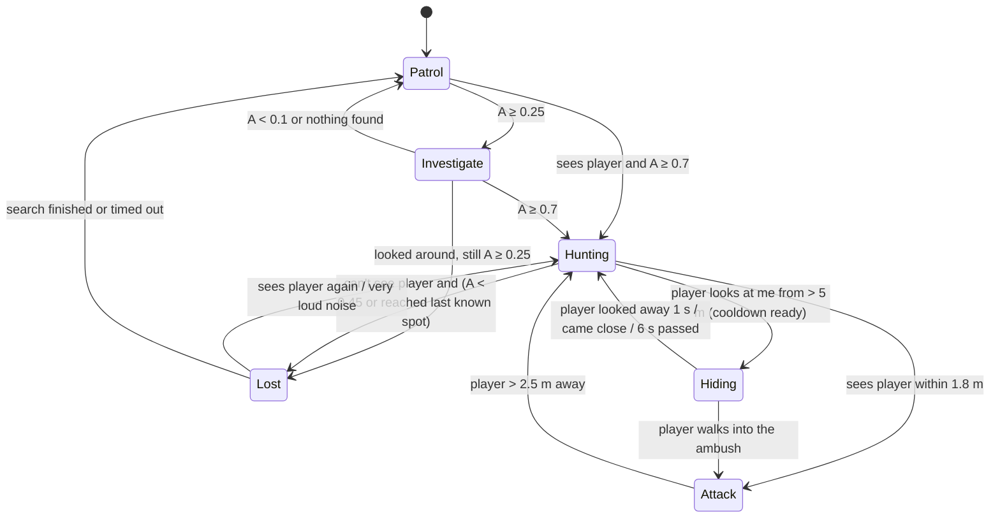

# Stealth Enemy — AI Architecture (SE3062, Peiris M P V P — IT24100245)

**Agent:** Stealth Enemy — sneaks around, hides, and hunts using sound.
**Architecture:** Finite State Machine (FSM) driven by a continuous **awareness** value (0–1), fed by a **sound-propagation hearing model** and a vision cone.

## Files (`Assets/Scripts/Agents/StealthEnemy/`)

| File | Role |
|---|---|
| `StealthBrain.cs` | FSM core: states dictionary, global transitions, anti-flicker rules, blackboard, `IStealthBody` interface, tuning values. Pure logic, no scene access. |
| `StealthStates.cs` | The 7 states (Patrol, Investigate, Hunting, Hiding, Attack, Lost, Dead) with `Enter / Tick / Exit`. |
| `StealthPerception.cs` | Senses: hearing (NavMesh path length + muffled through-wall route, inverse-square falloff), sight (cone + raycast), memory decay. |
| `StealthEnemyController.cs` | Body: implements `IStealthBody` with a NavMeshAgent; hide-spot search, attacks, stuck recovery, CSV log, debug overlay, gizmos. |
| `StealthHealth.cs` | Implements the shared `IDamageable`. |
| `NoiseSystem.cs` | Global noise bus. Also listens to `Throwable.OnImpact` (thrown rocks). |
| `PlayerNoiseEmitter.cs` | On the Player: footsteps (sneak/walk/sprint), gunshots and melee become noises. |

## Data flow

```
PlayerNoiseEmitter / Throwable / traps ──► NoiseSystem ──► StealthPerception ──┐
Player position + camera (sight) ───────────────────────► StealthPerception ──┤ writes
                                                                              ▼
                                                                  StealthBlackboard
                                                                              │ read
                                                                              ▼
                                                    StealthBrain (FSM) ─► IStealthBody ─► NavMeshAgent
```

## States and transitions (A = awareness)



Global ("any state") transitions: **took damage → Hunting**, **player died → Patrol**, **health 0 → Dead**.

## Key formulas

* **Perceived sound** = `L / (1 + (d / 6)²)` (inverse-square with a reference distance of 6 m).
  `d` is computed for two routes and the louder one wins:
  around the walls (NavMesh path length) or straight through them (×0.3 muffle if a wall blocks the line).
* **Sight gain per second** = `1.2 × distanceFactor × centreFactor × motionFactor`
  (close, centre of the view cone and moving = noticed fastest).
* **Memory**: after 2 s with no stimulus, awareness decays by 0.06 / s.
* **Hysteresis**: enter Hunting at 0.7, leave only below 0.45; enter Attack at 1.8 m, leave at 2.5 m; min 0.4 s per state; 6 s hide cooldown.

## Noise loudness (PlayerNoiseEmitter / NoiseSystem)

| Source | Loudness |
|---|---|
| Sneak step (hold Left Ctrl) | 0.05 |
| Walk step | 0.35 |
| Sprint step | 0.9 |
| Melee swing | 0.5 |
| Thrown rock impact | 0.15 × impact speed (≈ 2 for a hard throw) |
| Gunshot | 3.0 |

## Level integration (World Builder's Acoustic room)

* **PatrolPoint markers** in zone `Acoustic` become the patrol route automatically (when no patrol points are set by hand).
* **HidePoint markers** are tried first when the enemy needs cover (3 m cost bonus), if the player cannot see them.
* **SoundSource markers** (the ventilation fan) mask noise: anything within 4 m of one is perceived at 40% loudness, so the player can use machinery noise as cover.

## Logs for the report (`Application.persistentDataPath`)

* `stealth_log_<session>_<id>.csv` — every state change with its reason, noises, attacks, hide spots (F10 saves on demand).
* `stealth_sessions.csv` — one row per enemy per session: result, seconds in each state, state changes, noises heard, attacks, sneak attacks, designed hide spots used, stuck recoveries.

## Team integration hooks

* Any script can make a noise: `NoiseSystem.Emit(position, loudness, NoiseSource.Explosion);`
* `StealthEnemyController.AnyDied` (static event) — for the Spawn Director's kill count.
* `controller.StateChanged`, `controller.Attacked`, `controller.CurrentSpeedMode`, `controller.Agent` — for animation.
* Decision logs: `stealth_log_<session>_<id>.csv` in `Application.persistentDataPath` (F10 saves manually).
